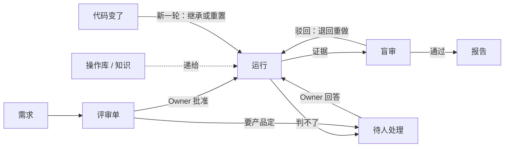

# 001 角色与概念

这篇给出 acceptkit 的角色和概念。代码、命令、看板和其他文档都用这些词。依据 [000 理念](000-philosophy.md)，只保留工作需要的概念。

## 角色：为什么是这四个

| 角色 | 是谁 | 负责 | 为什么必须有它 |
|---|---|---|---|
| **Owner** | 提需求、对结果负责的人 | 批准评审单（这次测什么）、拍板 finding（产品该怎么表现）、确认危险动作、补只有人知道的信息 | 授权不能来自模型。agent 不能替人批准任何东西，它填的「原话」工具也核实不了，所以人的回答要尽量从看板直接进来 |
| **执行者** | 用户的编码 agent，加载 acceptkit skill | 读需求、拆改动面、照卡片操作 App、处理工具处理不了的画面、交出看到的原文和判断 | 只有模型能把人话操作对到一个不断变化的界面上，能读懂需求的意思 |
| **acceptkit** | 本工具，不调用模型 | 保存状态、算出下一步、选设备、执行观测并判定、过闸、递经验、出报告 | 下一步、可用设备、证据是否成立、是否需要人批，都是能算出来的事，算出来就要可重复、可审计，不能取决于模型那一轮的状态 |
| **盲审** | 执行者派出的新上下文子 agent | 只看证据包，逐条判定证据撑不撑得住结论 | 执行者对自己跑过的东西有偏见，最容易放过一张其实停在登录页的截图。盲审看不到执行过程，只看得到证据 |

此外，项目可以用扩展（`pack.mjs`）接入私有的观测通道和领域命令。它属于 acceptkit 这一侧，规矩相同：不调用模型，结论原文落盘。

## 流程

需求先有评审单：改了哪些地方、每处用哪些已有用例、要新写哪些。Owner 批准后才能开跑。
每条用例一次运行，断言逐条从「待测」走到结论；证据交盲审，驳回的退回重做。
判不了的、要产品拍板的，变成待人处理，不挡与它无关的活。被测代码变了，开新一轮，逐条决定继承上一轮的结论还是重跑。

这条流程是**每条用例各走一遍**，不是整个需求齐步走。评审单批过之后又加了一条用例，回到「评审」的只有那一条，
已批过的照常往下走；看板上整轮显示的是各步上有几条用例（「评审 1 条 · 执行 20 条 · 报告 40 条 · 完成 3 条」），
并说清什么挡着什么。用例在哪一步不另存，从 `next` 的卡片推出（见 [002](002-protocol.md) 第三节），所以看板和执行者看到的是同一份计算。

## 概念

| 概念 | 是什么 | 守的规则 | 为什么要有它 |
|---|---|---|---|
| 需求 | 一次要验收的改动 | 一切运行都归属某个需求 | 结论要回答「这个改动能不能上」 |
| 评审单 | 需求的用例基线：改动面逐条列出，每处引用哪些用例、新建哪些 | 只有 Owner 能批；批准后加减用例要升版本并重新批，但重批的只是这次的变化：批过的用例照常跑，新加的批了才能跑；每次批准记下批了哪些 | 同一个需求，不同的人、不同的会话会测出不一样的范围；评审单让「测什么」先被人确认 |
| 用例 | 一棵操作树：节点是人话操作，节点上挂断言 | 断言自带观测规格（怎么取值、什么算通过）和适用范围（版本、平台、宿主）；新增、修改要过质量标准 | 人能读懂，工具能执行；适用范围由机器算，不靠人记 |
| 操作 | 操作库里的一条：一个平台中立的动作，每个平台、宿主一份做法 | 做法分推测 / 已确认 / 已验证，推测的不执行；还被用例引用的不能删 | 「怎么做到这一步」是项目经验，写一次，所有用例和以后的执行都用上 |
| 知识 | 项目的 Markdown 笔记：账号、坑、做法 | 带来源和状态；机密值标 `#secret`，不出现在证据和报告里 | 只能靠判断的经验存在这里，执行到那一步时按需取用 |
| 运行 | 一条用例的一次执行 | 只打一台设备；只对应一个被测包；所有证据落在它自己的目录 | 结论的最小单位，可复看、可复跑 |
| 断言结论 | 运行里一条断言的结果：待测 / 通过 / 失败 / 判不了 / 跳过 / 不适用 | 通过和失败必须有证据；端上运行记通过前必须有工具截的 app 画面；不适用只能由适用范围推出 | 「验过了」要能落到具体一条 |
| 证据 | 运行目录里的文件：观测原文、截图（带被测物信息的附带记录）、判定卡 | 由工具产出才算数；手工引用的原文必须在证据里找得到；内容变了要重新复核 | 结论只认证据 |
| 复核 | 盲审对一份证据的判定 | 判定从固定的几种里选；回写时证据必须和送审时一样；驳回的断言退回待测 | 执行者不复核自己 |
| Finding | 执行中发现、需要 Owner 拍板的事 | 写清性质、影响范围、为什么、选项和后果、推荐，用人话；看不懂可以退回重写 | 产品该怎么表现，只有 Owner 能定；定不了的 finding 等于没提 |
| 待人处理 | 等人回答的一件事：批准、拍板、解除阻塞、确认危险动作、补信息 | 一件事问一次；写清已经试过什么；不挡与它无关的活 | 人的注意力最贵，要问就问清 |
| 轮次 | 被测代码的一个版本 | 代码变了开新一轮；每条结论要么继承（写理由），要么重置重跑 | 代码一变，旧结论不一定还成立，但也不必全部重跑 |
| 设备租约 | 某次运行对某台设备的占用 | 设备身份不是它的连接地址；「空闲」必须观测得到；一次运行只打一台 | 同一轮的证据来自两台配置不同的机器，结论就读不清了 |

## 不要的概念

| 不要 | 原因 |
|---|---|
| acceptkit 自己调模型、自己跑循环（一期） | 模型和循环由用户的 agent 提供；我们只管状态、经验和闸门 |
| 让执行者直接写「通过」 | 结论由观测和规则算出；执行者交的是原文和判断 |
| 「目录里有截图」就算有证据 | 文字排版成的图、被弹窗挡住的图都是图；只认工具截的、查过遮蔽层的 |
| 用连接地址当设备身份 | 模拟器的地址按启动顺序分配，重启后会指向另一台 |
| 从自由文本里推断状态 | 「要不要人处理」「是不是被驳回」要用结构化字段表达，不靠正则从一段话里抠 |
| 取证手段的失败记成被测物失败 | 那是工具坏了，单独记、单独计数 |
| 执行者自己复核 | 见「盲审」 |
